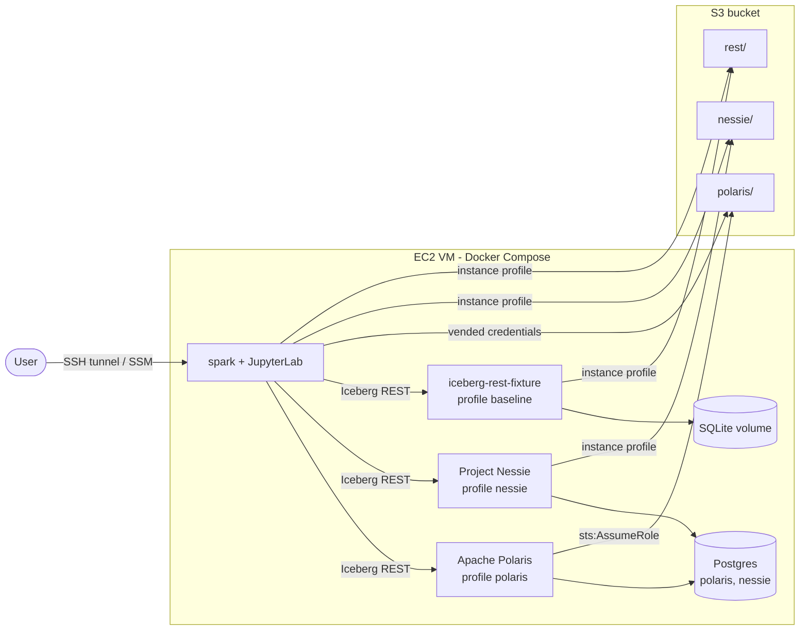

# iceberg-platform-poc

A reproducible lab to evaluate and compare two Apache Iceberg REST catalogs,
**Apache Polaris** and **Project Nessie**, on one Amazon EC2 VM with Docker Compose.
Data and metadata files are stored on a real AWS S3 bucket. The configuration reads every
storage setting from `.env`, so that a later phase can switch the lab to an on-premise
S3-compatible store (MinIO, RustFS); this switch is not verified yet.

The lab is a test environment, not a production environment.

## Status

The platform is complete. Stage 1 (AWS scripts), Phase 1 (Postgres, Spark image), Phase 2
(Polaris), Phase 3 (Nessie) and Phase 4 (baseline catalog `rest`) are done. The current scope is
to build the platform for study, not to compare the catalogs. The scenario notebooks (Phase 5)
and the evaluation (Phase 6) are deferred to a later stage.

## What the lab contains

Spark sees the catalogs that are on (see [Choose the catalogs](#choose-the-catalogs)).
Each catalog writes to its own S3 prefix.

| Spark catalog | Service | S3 prefix | S3 credentials of Spark |
|---|---|---|---|
| `polaris` | Apache Polaris | `s3://${S3_BUCKET}/polaris/` | Vended by Polaris (role `polaris-s3-access`) |
| `nessie` | Project Nessie (Iceberg REST endpoint) | `s3://${S3_BUCKET}/nessie/` | VM instance profile |
| `rest` (Compose profile `baseline`) | `apache/iceberg-rest-fixture` | `s3://${S3_BUCKET}/rest/` | VM instance profile |



`postgres` and `spark` always run. The catalogs are Compose profiles and are off by default.
The `spark` image also has the Nessie CLI (command `nessie`).

## Prerequisites

- An EC2 VM with an IAM role (instance profile). Size, operating system and security group:
  [aws/README-aws.md, "VM sizing"](aws/README-aws.md#vm-sizing).
- On the VM: Docker Engine with the Compose plugin, `make`, `git`, `jq`, and your user in the
  `docker` group ([aws/README-aws.md, "Software on the VM"](aws/README-aws.md#software-on-the-vm)).
- Access to AWS CloudShell with administrative credentials, in the region of the VM. Only
  CloudShell creates the AWS resources; the VM never has administrative credentials.
- SSH access to the VM (or the SSM agent on the VM).

## First start

Do these steps once. Steps 1-2 run in CloudShell, the other steps on the VM.

1. In CloudShell, run `aws/setup.sh`
   ([aws/README-aws.md, "Run setup.sh"](aws/README-aws.md#run-setupsh)). It creates the bucket,
   the policy of the VM role and the role `polaris-s3-access`.
2. Copy the four lines that `setup.sh` prints at the end (`S3_BUCKET`, `AWS_REGION`,
   `POLARIS_ROLE_ARN`, `POLARIS_EXTERNAL_ID`).
3. On the VM, clone the repository and go to its folder.
4. Copy the template: `cp .env.example .env`.
5. In `.env`, write the four values of step 2 on the lines that already exist. Do not add
   duplicate lines.
6. In `.env`, replace each `change-me` with a value of your choice, for example the output of
   `openssl rand -hex 16`. The Polaris root id and secret must not contain `"`, `\` or `:`.
7. In `.env`, set `LAB_UID` to the output of `id -u`.
8. In `.env`, set `COMPOSE_PROFILES` to the catalog that you want, for example
   `COMPOSE_PROFILES=nessie`. Leave it empty for no catalog.
9. Check the S3 access of the VM
   ([aws/README-aws.md, "Check from the VM"](aws/README-aws.md#check-from-the-vm)).
10. Start the lab: `make up`. The first start builds the Spark image (several minutes).
11. Test the lab: `make smoke-test`. Every test ends with `all assertions passed` or `ok` lines.

`.env` holds passwords and account values. It is git-ignored: never commit it and never share it.

## Choose the catalogs

1. Set `COMPOSE_PROFILES` in `.env`: `polaris`, `nessie`, `baseline` (Spark catalog `rest`),
   or a list (`nessie,polaris`, no spaces). Leave it empty for no catalog.
2. Run `make up`. It starts the catalogs in `COMPOSE_PROFILES` and stops the others.
   The data of a stopped catalog stays (Postgres database and S3 prefix).
3. Run `make smoke-test`. It tests the base stack and each catalog that is on.

The catalogs do not have to run together. To compare them, run the same test or notebook once
with each catalog.

## Daily use

- **Spark SQL shell**: `make sql-polaris`, `make sql-nessie` or `make sql-rest`. The catalog
  must be on: otherwise Spark answers "catalog not found". Example:

  ```sql
  CREATE NAMESPACE IF NOT EXISTS demo;
  CREATE TABLE demo.t (id INT, name STRING) USING iceberg;
  INSERT INTO demo.t VALUES (1, 'a');
  SELECT * FROM demo.t;
  ```

- **Nessie CLI**: `make nessie-cli` (the catalog `nessie` must be on). The CLI is also in the
  JupyterLab terminal: run `nessie`. It connects to the Nessie service of the lab. Examples:

  ```text
  LIST REFERENCES;
  CREATE BRANCH dev FROM main;
  USE REFERENCE dev;
  SHOW LOG;
  MERGE dev INTO main;
  ```

  Without a terminal, run one command:
  `docker compose exec -T spark nessie -q --stdout -c "LIST REFERENCES"`.
  Documentation: <https://projectnessie.org/nessie-latest/cli/>.

- **JupyterLab**: open <http://localhost:8888> through a tunnel (see
  [Access from your machine](#access-from-your-machine)) and enter `JUPYTER_TOKEN` from
  `.env`. Save your notebooks in `scenarios/`: this folder is on the disk of the VM, so the
  notebooks stay after a restart. In a notebook, the catalogs that are on are already
  configured:

  ```python
  from pyspark.sql import SparkSession
  spark = SparkSession.builder.getOrCreate()
  spark.sql("SHOW NAMESPACES IN nessie").show()
  ```

- **Drop a Polaris table with its files**: `DROP TABLE polaris.<namespace>.<table> PURGE`.
  Without `PURGE`, the files stay under `polaris/`, and the VM role cannot delete them (only
  CloudShell can).
- **Drop a baseline table with its files**: `DROP TABLE rest.<namespace>.<table> PURGE`.
  Without `PURGE`, the files stay under `rest/`. The VM role can delete them with `aws s3 rm`.
- **Logs**: `make logs`.

## Make targets

| Target | What it does |
|---|---|
| `make up` | Builds the Spark image if necessary, starts `postgres`, `spark` and the catalogs in `COMPOSE_PROFILES`, stops the other catalogs, and waits until all services are healthy |
| `make down` | Stops and removes every container, of every catalog. The data stays |
| `make reset` | Like `make down`, and also **deletes the volumes**: all Polaris and Nessie metadata (Postgres) and the baseline catalog (SQLite) are lost. The S3 files stay |
| `make smoke-test` | Runs the acceptance tests of the base stack and of each catalog that is on |
| `make sql-polaris`, `make sql-nessie`, `make sql-rest` | Opens a Spark SQL shell on the catalog |
| `make nessie-cli` | Opens the Nessie CLI on the Nessie service (the catalog `nessie` must be on) |
| `make logs` | Shows the logs of the running services |
| `make lint` | Static checks: script syntax, JSON, Compose file, no secret in tracked files |
| `make test-aws` | Tests the AWS scripts against a stub AWS CLI (no AWS access) |

## Access from your machine

The lab publishes its ports on `127.0.0.1` of the VM only. Nessie, the baseline catalog and
the Spark UI have no authentication, so do not open these ports in the security group. Use a
tunnel instead.

| Service | VM port | Address on your machine |
|---|---|---|
| JupyterLab (asks for `JUPYTER_TOKEN` from `.env`) | 8888 | <http://localhost:8888> |
| Spark UI (only while a Spark session runs) | 4040 | <http://localhost:4040> |
| Nessie API | 19120 | <http://localhost:19120/api/v2/trees> |
| Nessie management (health) | 9000 | <http://localhost:9000/q/health/ready> |
| Polaris API (needs a token) | 8181 | <http://localhost:8181/api/management/v1/catalogs> |
| Polaris management (health) | 8182 | <http://localhost:8182/q/health/ready> |
| Baseline REST catalog (no authentication) | 8183 | <http://localhost:8183/v1/config> |

A catalog port answers only when the catalog is on (`COMPOSE_PROFILES`).

### SSH tunnel

1. Open a terminal on your machine.
2. Start the tunnel. Replace `<key>.pem` with your SSH key and `<vm-public-ip>` with the
   public IP address of the VM:

   ```bash
   ssh -i <key>.pem -N \
     -L 8888:127.0.0.1:8888 \
     -L 4040:127.0.0.1:4040 \
     -L 19120:127.0.0.1:19120 \
     -L 9000:127.0.0.1:9000 \
     -L 8181:127.0.0.1:8181 \
     -L 8182:127.0.0.1:8182 \
     -L 8183:127.0.0.1:8183 \
     admin@<vm-public-ip>
   ```

3. Keep the terminal open while you use the lab. `-N` opens the tunnel without a shell.
4. Open the addresses of the table in your browser.

If a port is already in use on your machine, change only the first number. For example,
`-L 19000:127.0.0.1:9000` makes the Nessie management port available on
<http://localhost:19000>.

### SSM port forwarding

Use this method when the VM has the SSM agent and you do not use SSH. The AWS CLI and the
Session Manager plugin must be installed on your machine.

1. Start one session for each port. Replace `<instance-id>` with the ID of the VM:

   ```bash
   aws ssm start-session --target <instance-id> \
     --document-name AWS-StartPortForwardingSession \
     --parameters '{"portNumber":["8888"],"localPortNumber":["8888"]}'
   ```

2. Repeat the command in a new terminal for each other port (4040, 19120, 9000, 8181, 8182, 8183).

## Stop and clean up

- **At the end of a work session**: run `make down`, then stop the VM in the EC2 console. A
  stopped VM costs nothing for compute, but its EBS volume and the S3 bucket still cost money.
- **To remove the lab completely**:
  1. On the VM, run `make down`.
  2. In CloudShell, run `aws/teardown.sh`
     ([aws/README-aws.md, "Run teardown.sh"](aws/README-aws.md#run-teardownsh)). It deletes
     the bucket (after you type its name), the role `polaris-s3-access` and the lab policy of
     the VM role.
  3. Terminate the VM, or keep it for other work.
- Costs: [aws/README-aws.md, "Costs"](aws/README-aws.md#costs).

## Troubleshooting

| Symptom | Cause | What to do |
|---|---|---|
| `Unable to locate credentials`, or an S3 call hangs, in a container | The IMDS hop limit of the VM is 1, so the containers cannot reach the instance profile | In CloudShell, run `aws/setup.sh` again (it sets the hop limit to 2) |
| `aws s3 ls` on the VM uses the wrong identity | `AWS_*` variables or a `[default]` profile have priority over the instance profile | See [aws/README-aws.md, "Check from the VM"](aws/README-aws.md#check-from-the-vm) |
| `make up` fails, and `docker compose logs polaris-setup` says `secrets/ is not writable` | Docker created `secrets/` as root, because the stack was started without `make up` | Run `sudo chown $(id -u) secrets`, then `make up` |
| The polaris-setup log says `credentials reset` | The file `secrets/spark_user.env` was missing or did not work, so setup made new credentials | Run `docker compose restart spark`: a running `spark` keeps the old credentials |
| Spark says `catalog not found` | The catalog is off, or `COMPOSE_PROFILES` has a typo (the spark log says `no Spark catalog for profile ...`) | Check `COMPOSE_PROFILES` in `.env`, then run `make up` |
| HTTP 401 from Polaris in a long Spark session | The Polaris token of the session is no longer valid. Tokens last one hour; the Iceberg client normally refreshes them, but a refresh can fail, for example after a restart of Polaris | Start a new Spark session (`make sql-polaris`, or restart the notebook kernel) |
| `make smoke-test` fails on `catalog-smoke.sh polaris` with `files left under ...` | A Polaris table was dropped without its files | Delete the listed files from CloudShell (`aws s3 rm`); the VM role cannot delete under `polaris/` |
| `make up` warns `The "NESSIE_CLI_VERSION" variable is not set`, and the Spark build fails on the Nessie CLI download (HTTP 404) | `.env` was made before the Nessie CLI was added, so it has no `NESSIE_CLI_VERSION` and `NESSIE_CLI_SHA1` | Copy the two lines `NESSIE_CLI_VERSION=...` and `NESSIE_CLI_SHA1=...` from `.env.example` to `.env`, then run `make up` |
| A service is not healthy after `make up` | A service did not start | Run `docker compose ps -a`, then `docker compose logs <service>` |

## On-premise S3 storage (not verified)

`.env` has the settings for an S3-compatible store: `S3_ENDPOINT`, `S3_PATH_STYLE_ACCESS`,
`AWS_ACCESS_KEY_ID` and `AWS_SECRET_ACCESS_KEY` (there is no IMDS on-premise). The services
read them, but the lab does not test this case yet. Known gaps: the AWS CLI in the `spark`
container ignores `S3_ENDPOINT`, Polaris credential vending needs an STS endpoint or
`stsUnavailable`, the Nessie management port 9000 is also the default MinIO port, and the
baseline catalog has no S3 endpoint setting yet. A later phase verifies the procedure
(`NOTES.md`).

## Documents

| Document | Content |
|---|---|
| [Requirements](docs/req/prompt-agente-lab-iceberg-polaris-nessie.md) | Original requirements (Italian) |
| [Design spec](docs/superpowers/specs/2026-10-28-iceberg-catalog-lab-design.md) | Architecture, services, S3 access model, tests |
| [AWS runbook](aws/README-aws.md) | VM sizing, AWS setup and teardown, costs |
| [Notes](NOTES.md) | Deviations from the requirements and findings |
| [Versions](VERSIONS.md) | Pinned versions with sources |
| [Plan: Stage 1 and Phase 1](docs/superpowers/plans/2026-10-28-stage1-and-phase1.md) | Task-by-task implementation plan |
| [Plan: Phase 3 (Nessie)](docs/superpowers/plans/2026-10-28-phase3-nessie.md) | Task-by-task implementation plan |
| [Plan: Phase 2 (Polaris)](docs/superpowers/plans/2026-10-29-phase2-polaris.md) | Task-by-task implementation plan |
| [Plan: Phase 4 (baseline)](docs/superpowers/plans/2026-10-29-phase4-baseline.md) | Task-by-task implementation plan |
| [Plan: Nessie CLI](docs/superpowers/plans/2026-10-29-nessie-cli.md) | Task-by-task implementation plan |
| [Handoff](docs/HANDOFF.md) | Current state and decisions (for the next work session) |

## License

Copyright 2026 the iceberg-platform-poc authors.

Licensed under the Apache License, Version 2.0. See [LICENSE](LICENSE).
