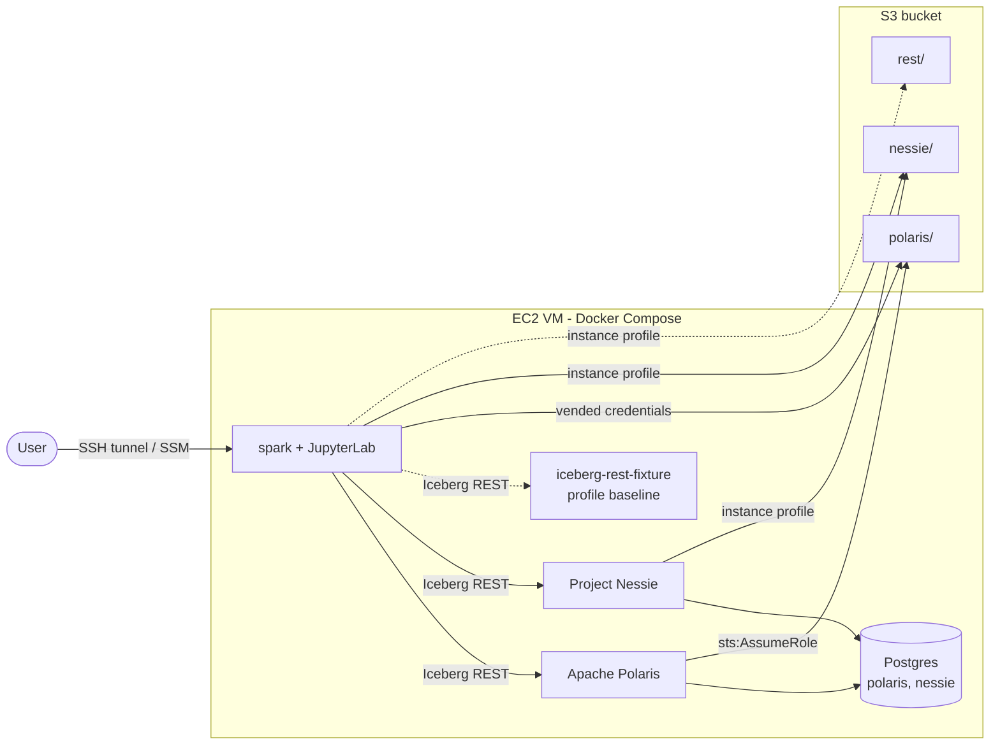

# iceberg-platform-poc

A reproducible lab to evaluate and compare two Apache Iceberg REST catalogs,
**Apache Polaris** and **Project Nessie**, on one Amazon EC2 VM with Docker Compose.
Data and metadata files are stored on a real AWS S3 bucket. The lab can switch to an
on-premise S3-compatible store (MinIO, RustFS) by editing `.env` only.

The lab is a test environment, not a production environment.

## Status

Work in progress. Stage 1 (AWS scripts) and Phase 1 (Postgres, Spark image) are done.
Phase 3 adds Nessie, before Phase 2 (Polaris), see `NOTES.md` D9.

Quick check on the VM:

1. Run `make up`.
2. Run `make smoke-test`.
3. Run `make down`.

Open a Spark SQL shell on the Nessie catalog with `make sql-nessie`.

| Document | Content |
|---|---|
| [Requirements](docs/req/prompt-agente-lab-iceberg-polaris-nessie.md) | Original requirements (Italian) |
| [Design spec](docs/superpowers/specs/2026-10-28-iceberg-catalog-lab-design.md) | Architecture, services, S3 access model, tests |
| [Plan: Stage 1 and Phase 1](docs/superpowers/plans/2026-10-28-stage1-and-phase1.md) | Task-by-task implementation plan |
| [Plan: Phase 3 (Nessie)](docs/superpowers/plans/2026-10-28-phase3-nessie.md) | Task-by-task implementation plan |
| [Handoff](docs/HANDOFF.md) | Current state and decisions |

## Access from your machine

The lab publishes its ports on `127.0.0.1` of the VM only. Nessie and the Spark UI have no
authentication, so do not open these ports in the security group. Use a tunnel instead.

| Service | VM port | Address on your machine |
|---|---|---|
| JupyterLab (asks for `JUPYTER_TOKEN` from `.env`) | 8888 | <http://localhost:8888> |
| Spark UI (only while a Spark session runs) | 4040 | <http://localhost:4040> |
| Nessie API | 19120 | <http://localhost:19120/api/v2/trees> |
| Nessie management (health) | 9000 | <http://localhost:9000/q/health/ready> |

### SSH tunnel

1. Open a terminal on your machine.
2. Start the tunnel. Replace `<key>.pem` with your SSH key and `<vm-public-ip>` with the
   public IP address of the VM:

   ```bash
   ssh -i <key>.pem -N \
     -L 8888:127.0.0.1:8888 \
     -L 4040:127.0.0.1:4040 \
     -L 19120:127.0.0.1:19120 \
     -L 9000:127.0.0.1:9000 \
     admin@<vm-public-ip>
   ```

3. Keep the terminal open while you use the lab. `-N` opens the tunnel without a shell.
4. Open the addresses of the table in your browser.

If a port is already in use on your machine, change only the first number. For example,
`-L 19000:127.0.0.1:9000` makes the Nessie management port available on
<http://localhost:19000>.

### SSM port forwarding

Use this method when the VM has the SSM agent and you do not use SSH. The AWS CLI and the
Session Manager plugin must be installed on your machine.

1. Start one session for each port. Replace `<instance-id>` with the ID of the VM:

   ```bash
   aws ssm start-session --target <instance-id> \
     --document-name AWS-StartPortForwardingSession \
     --parameters '{"portNumber":["8888"],"localPortNumber":["8888"]}'
   ```

2. Repeat the command in a new terminal for each other port (4040, 19120, 9000).

## What the lab contains

One Spark session sees the catalogs below. Each catalog writes to its own S3 prefix.

| Spark catalog | Service | S3 prefix |
|---|---|---|
| `polaris` | Apache Polaris | `s3://${S3_BUCKET}/polaris/` |
| `nessie` | Project Nessie (Iceberg REST endpoint) | `s3://${S3_BUCKET}/nessie/` |
| `rest` (optional, Compose profile `baseline`) | `apache/iceberg-rest-fixture` | `s3://${S3_BUCKET}/rest/` |



The full README (prerequisites, start procedure, access through SSH and SSM, service URLs,
on-premise storage, teardown, troubleshooting) is written in the last phase of the project.

## License

Copyright 2026 the iceberg-platform-poc authors.

Licensed under the Apache License, Version 2.0. See [LICENSE](LICENSE).
