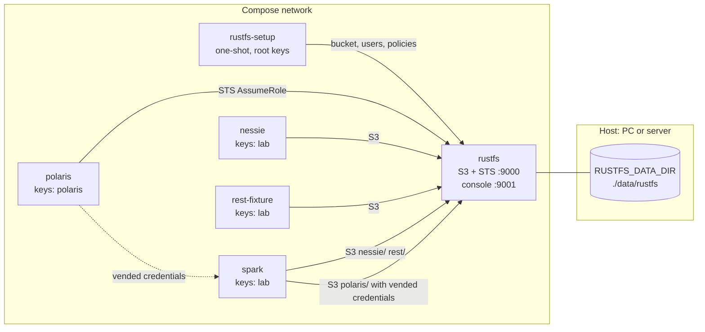

# On-premise variant with RustFS — design

- Date: 2026-10-29
- Parent spec: `docs/superpowers/specs/2026-10-28-iceberg-catalog-lab-design.md` (section 5.5)
- Status: approved in brainstorming session

## 1. Goal

Run the lab on a PC or on an on-premise server, without AWS. RustFS replaces AWS S3: it
exposes the S3 API and STS, and it keeps its data in a directory on the local filesystem.
Every catalog of the lab (Polaris, Nessie, the `rest` baseline) works on RustFS. Polaris
credential vending works as on AWS, through the RustFS STS.

The AWS stack stays the default. The user selects the RustFS variant in `.env` only.

## 2. Choice of RustFS

Market analysis on 2026-10-29. MinIO Community Edition is archived (no binaries since
October 2025, archived in 2026) and is AGPLv3.

| Candidate | License | Result |
|---|---|---|
| RustFS 1.0.4 | Apache 2.0 | Chosen. Implements STS `AssumeRole`. The Polaris project has a RustFS guide (`site/content/guides/rustfs/`). The web console shows the storage. |
| Versity S3 Gateway | Apache 2.0 | Rejected: objects stay plain files, but there is no STS, so Polaris cannot vend credentials (`stsUnavailable`). |
| SeaweedFS | Apache 2.0 | Rejected: too many components for a lab. |
| Garage | AGPLv3 | Rejected: GPL family. |
| Ceph RGW | LGPL | Rejected: too heavy, copyleft. |
| S3Proxy | Apache 2.0 | Rejected: limited S3 coverage, no STS. |

RustFS keeps objects in an internal on-disk format, not as plain files. The user accepts
this: the RustFS web console shows the buckets and the objects.

## 3. Facts about RustFS (verified on 2026-10-29)

- Image `rustfs/rustfs:1.0.4` (Docker Hub). S3 API and STS on port 9000, console on 9001.
- Root keys: `RUSTFS_ACCESS_KEY`, `RUSTFS_SECRET_KEY`. Data directory: `RUSTFS_VOLUMES`
  (default `/data`). Region: `RUSTFS_REGION` (default `us-east-1`).
- The image runs as `rustfs` (uid 10001) and has no healthcheck. It has `curl`. Health
  endpoint: `http://127.0.0.1:9000/health`.
- `AssumeRole` is on the S3 port. RustFS ignores `RoleArn`. The temporary credentials
  inherit the policies of the calling user, restricted by the session policy (maximum
  2048 bytes). The caller must be a built-in user (not a service account, not a console
  access key) (rustfs/rustfs issue 4832).
- Admin client: `rustfs/rc:v0.1.36` (Apache 2.0). It creates buckets, users and policies.
  The MinIO client `mc` (AGPL) is not used.
- Polaris 1.8.0 `AwsStorageConfigInfo` has `endpoint`, `endpointInternal`, `stsEndpoint`
  (default: `endpointInternal`, then `endpoint`), `stsUnavailable` and `pathStyleAccess`.
- `apache/iceberg-rest-fixture:1.10.1` does not return the S3 endpoint or path-style
  access to clients: Spark must set them itself.

## 4. Selection of the variant

`.env` gets one line:

```
COMPOSE_FILE=docker-compose.yml:docker-compose.rustfs.yml
```

Docker Compose reads `COMPOSE_FILE` and merges the two files. Without this line, the stack
is the AWS stack, unchanged. `make up`, `make sql-*`, `make nessie-cli` and
`make smoke-test` do not change. `COMPOSE_PROFILES` selects the catalogs, as before.

## 5. Architecture



## 6. Components

### 6.1 `docker-compose.rustfs.yml` (new)

New services:

| Service | Image | Function |
|---|---|---|
| `rustfs` | `rustfs/rustfs:1.0.4` | S3 API and STS, web console. Data in the bind mount `${RUSTFS_DATA_DIR:-./data/rustfs}`. Host ports `127.0.0.1:9100` (API) and `127.0.0.1:9101` (console): the Nessie management port already uses 9000. Healthcheck on `/health`. Region `${AWS_REGION}`. No Compose profile: it always runs in the variant. |
| `rustfs-setup` | `rustfs/rc:v0.1.36` | One-shot, idempotent. With the root keys, it creates the bucket `${S3_BUCKET}`, the users `polaris` and `lab`, and their policies (section 7). It stops with a clear message when a key in `.env` is empty. |

Overrides of the existing services (environment and `depends_on` only):

| Service | Change |
|---|---|
| `nessie` | S3 endpoint `http://rustfs:9000`, path-style access, keys of the user `lab`. |
| `rest-fixture` | `CATALOG_S3_ENDPOINT=http://rustfs:9000`, `CATALOG_S3_PATH__STYLE__ACCESS=true`, keys of the user `lab`. |
| `polaris` | Keys of the user `polaris`: Polaris calls the RustFS STS with them. |
| `polaris-setup` | `S3_ENDPOINT=http://rustfs:9000`, `S3_PATH_STYLE_ACCESS=true`. `POLARIS_ROLE_ARN` is a fixed placeholder ARN, because RustFS ignores it. `POLARIS_EXTERNAL_ID` is a fixed placeholder. |
| `spark` | `S3_ENDPOINT=http://rustfs:9000`, `S3_PATH_STYLE_ACCESS=true`, keys of the user `lab`, `AWS_ENDPOINT_URL=http://rustfs:9000` (the AWS CLI in the container then uses RustFS). |

Every service that uses S3 waits for `rustfs-setup` (`service_completed_successfully`).

### 6.2 Changes to existing files

- `spark/conf/s3-endpoint/baseline.conf` (new) and `spark/entrypoint.sh`: `s3.endpoint` and
  `s3.path-style-access` for the catalog `rest`. The entrypoint appends this template only
  when `S3_ENDPOINT` is set. On AWS the rendered file does not change (an empty endpoint
  value can break `S3FileIO`, `NOTES.md`).
- `.env.example`: a section "RustFS (on-premise)" with `COMPOSE_FILE` commented out,
  `RUSTFS_DATA_DIR`, `RUSTFS_ROOT_ACCESS_KEY` / `RUSTFS_ROOT_SECRET_KEY`,
  `RUSTFS_POLARIS_ACCESS_KEY` / `RUSTFS_POLARIS_SECRET_KEY`, `RUSTFS_LAB_ACCESS_KEY` /
  `RUSTFS_LAB_SECRET_KEY`. The user chooses the values, as for the other local secrets.
- `.gitignore`: `data/`.
- `polaris/setup/setup.sh`: no change is expected. It already sends `endpoint` and
  `pathStyleAccess` when `S3_ENDPOINT` is set; `stsEndpoint` defaults to `endpoint`.

### 6.3 Data directory and UID

The bind mount keeps the data in a host directory, visible on Linux, macOS and Windows
(WSL2). The image runs as uid 10001, so on Linux the directory would belong to another
user. The design runs `rustfs` with `user: ${LAB_UID:-1000}`, so that the host user owns
the files. The implementation verifies that RustFS starts with this UID. If it does not,
the fallback is a documented `chown 10001` on the host directory.

`make reset` (`docker compose down -v`) does not delete the bind mount. The README tells
the user how to delete the RustFS data.

### 6.4 Separate state for the variant

The catalog state of the AWS stack points to AWS S3: the Polaris catalog `lab_catalog`
(with the AWS role ARN), the Nessie tables and the `rest` catalog. `polaris-setup` does not
change a catalog that is already present. So the RustFS variant has its own state, and the
AWS state stays intact:

| State | AWS stack | RustFS variant |
|---|---|---|
| Postgres data (Polaris and Nessie) | volume `pgdata` | volume `pgdata-rustfs` |
| `rest` catalog (SQLite) | volume `rest-fixture-data` | volume `rest-fixture-data-rustfs` |
| `spark_user` credentials | `secrets/spark_user.env` | `secrets/rustfs/spark_user.env` |

The override replaces these mounts (Compose merges volumes by container path). `make up`
creates `secrets/rustfs/` and the RustFS data directory as the host user, before Docker
can create them as root.

## 7. Credentials and policies

| User | Permissions | Used by |
|---|---|---|
| root | everything | `rustfs-setup` and the web console only |
| `polaris` | read, write and delete on `${S3_BUCKET}/polaris/*`; list on the bucket; `sts:AssumeRole` | Polaris (STS caller) |
| `lab` | read, write and delete on `nessie/*` and `rest/*`; list on the bucket, `polaris/` included; no read or write under `polaris/` | Spark, Nessie, rest-fixture |

This repeats the AWS model (`NOTES.md` D3): the static keys of Spark cannot read or write
the Polaris tables. Spark reads and writes them only with the credentials that Polaris
vends.

Polaris flow:

1. Spark authenticates to Polaris as `spark_user`.
2. Polaris calls `AssumeRole` on `http://rustfs:9000` with the keys of `polaris` and a
   session policy for the table location.
3. Polaris returns the temporary credentials and the endpoint `http://rustfs:9000` to Spark.
4. Spark reads and writes the table files with the temporary credentials.

## 8. Tests

| Test | Change | Purpose |
|---|---|---|
| `tests/s3-access.sh`, `tests/s3_access.py` | None (they already read `S3_ENDPOINT`) | The `lab` keys write and read under `rest/`, and a write under `polaris/` is denied. |
| `tests/smoke-test.sh` | Runs the setup check when the service `rustfs` is in the configuration | Entry point, unchanged for AWS. |
| `tests/rustfs-setup.sh` (new) | — | A second run of `rustfs-setup` exits 0 (idempotency). |
| `tests/catalog-smoke.sh`, `tests/*-service.sh` | None | Each catalog works on RustFS; Polaris works with vended credentials. |
| `tests/lint.sh`, `tests/check-no-secrets.sh` | Cover the new files | Static checks. |
| `tests/compose-variant.sh` (new, in `make lint`) | — | `docker compose config` with and without the override: both are valid, the AWS configuration has no RustFS setting, the variant has the settings of sections 6.1 and 6.4. |
| `tests/catalog-selection.sh` | Skips on the variant | It checks the service list of the AWS stack. |

Success criteria:

1. `make smoke-test` passes on the RustFS variant on the Linux VM, for each catalog alone
   and for the three catalogs together.
2. `make smoke-test` passes on the AWS stack (regression).
3. `make lint` passes.

## 9. Documentation

- `README.md`: the section "On-premise S3 storage (not verified)" becomes "On-premise with
  RustFS": the procedure (verified on Linux) and notes for macOS and Windows (WSL2), marked
  as not verified. Access to the console through an SSH tunnel.
- `VERSIONS.md`: the images `rustfs/rustfs` and `rustfs/rc`, with sources.
- `NOTES.md`: D15 (choice of RustFS, section 2) and the update of the on-premise items in
  "Findings" and "Open investigations".

## 10. Out of scope

- Verification on macOS and Windows (documented, not verified).
- Multi-node RustFS, TLS, virtual-host-style addressing.
- Access to RustFS from clients outside the Compose network (Polaris `endpoint` is
  `http://rustfs:9000`, reachable only inside the network).
- Migration of data between AWS S3 and RustFS.

## 11. Work organization

One plan (`superpowers:writing-plans`), one GitHub issue per task, branch
`feat/rustfs-onprem`, one PR opened at the end.
