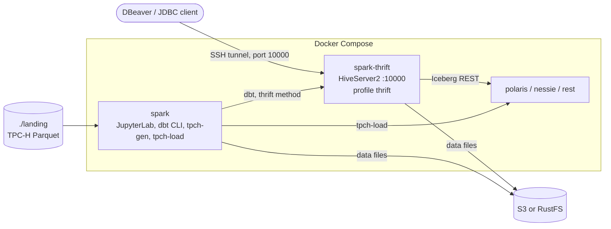

# ELT with dbt and a Spark Thrift Server — design

- Date: 2026-10-30
- Parent spec: `docs/superpowers/specs/2026-10-28-iceberg-catalog-lab-design.md`
- Status: approved in brainstorming session

## 1. Goal

Add a minimal ELT pipeline to the lab:

- **EL:** a PySpark job loads TPC-H Parquet files from a local directory into Iceberg tables.
- **T:** a dbt project transforms the raw tables into staging and mart tables.

The same dbt project runs on each catalog of the lab (`polaris`, `nessie`, `rest`). The
target of the dbt run selects the catalog. The models do not change.

A Spark Thrift Server (HiveServer2 protocol) runs dbt. External JDBC clients, for example
DBeaver, use the same Thrift Server to query the Iceberg tables.

## 2. Decisions taken in the brainstorming session

| # | Decision | Rejected alternatives |
|---|---|---|
| 1 | The dbt project is generic: three targets, one per catalog | One catalog only; Nessie branches (write-audit-publish) |
| 2 | Ingestion = Spark batch from local files | dbt seeds (small tables only); PyIceberg; Structured Streaming; `add_files` (needs files on S3) |
| 3 | Data = TPC-H, generated locally with the DuckDB `tpch` extension, configurable scale factor | Public dataset download; synthetic data script |
| 4 | dbt connects with the `thrift` method to a new Spark Thrift Server service | `session` method in the `spark` container (no JDBC access for external clients); separate dbt container (more cost, no benefit) |
| 5 | The pipeline has one incremental model with the `merge` strategy, fed by a two-step load | No incremental model |

## 3. Facts (checked on 2026-10-30)

- `dbt-spark` 1.11.0 (Apache-2.0) requires Python >= 3.10 and allows `pyspark` < 5. The
  `PyHive` extra installs `PyHive[hive-pure-sasl]` ~= 0.7.0 and `thrift` < 0.23.0.
- `dbt-core` 1.12.6 (Apache-2.0). `PyHive` 0.7.0 (Apache-2.0). `thrift` 0.22.0
  (Apache-2.0). `pure-sasl` 0.6.2 (MIT). No GPL-family license.
- `duckdb` (MIT): 2.0.0 requires Python >= 3.11. The Spark image has Python 3.10, so the
  lab pins `duckdb` 1.5.6, the last release with Python 3.10 wheels (x86_64 and aarch64).
- `dbt-spark` uses a two-level namespace: "always schema, never database". The catalog is
  not part of the model name. Each target selects the catalog with the Spark property
  `spark.sql.defaultCatalog`.
- `dbt-spark` supports `file_format: iceberg` and the incremental strategy `merge` for
  Iceberg on Apache Spark.
- The documentation of dbt marks the `session` method as "advanced, experimental"; the
  `thrift` method is for a Thrift Server in front of a Spark cluster.

## 4. Open technical points (spike, first task of the plan)

The first task of the plan checks these points on the workstation. If a point fails, the
implementer stops and the user decides before the design changes.

1. The image `apache/spark:4.1.3-scala2.13-java17-python3-ubuntu` contains the Thrift
   Server classes (`org.apache.spark.sql.hive.thriftserver.HiveThriftServer2`) and
   `bin/beeline`.
2. The Thrift Server starts with the lab Spark configuration
   (`spark.sql.catalogImplementation=in-memory`), or it needs Hive support. If it needs Hive
   support, a local Derby metastore inside the `spark-thrift` container is acceptable: the
   Iceberg catalogs do not use it.
3. A dbt target can set `spark.sql.defaultCatalog` for its connection: first with
   `server_side_parameters` in `profiles.yml`, else with `SET spark.sql.defaultCatalog=<x>`
   in an `on-run-start` hook.
4. The three catalogs support Iceberg views through the REST API (Polaris 1.8.0, Nessie
   0.109.0, `apache/iceberg-rest-fixture` 1.10.1), with Iceberg Spark runtime 1.11.0.
   If one catalog does not support them, the staging models are tables on every catalog.
5. The DuckDB `tpch` extension works without a download at run time (bundled in the
   `duckdb` wheel), or it can be installed at image build time.
6. The authentication mode of the Thrift Server (`NOSASL` or `NONE`) that both PyHive and
   the Hive JDBC driver of DBeaver accept.

## 5. Architecture

## 6. Components

### 6.1 Service `spark-thrift` (new, Compose profile `thrift`)

- Same image as `spark` (`iceberg-lab-spark`), same entrypoint. The entrypoint renders the
  Spark configuration of the catalogs that are on, then runs the Thrift Server in the
  foreground (the arguments of the service).
- Port `127.0.0.1:10000:10000`. External clients use the SSH tunnel or SSM port forwarding
  that the README already documents.
- No authentication (`hive.server2.authentication`: `NOSASL` or `NONE`, spike point 6). The port is bound to localhost only.
  The README records this as a lab limit.
- Same environment and secrets as `spark` (catalog credentials, `LAB_CATALOGS`, S3
  settings). It depends on the catalogs as `spark` does (`required: false`).
- Healthcheck: `beeline` runs `SELECT 1` on port 10000.
- `docker-compose.rustfs.yml` gives `spark-thrift` the same overrides as `spark`
  (`S3_ENDPOINT`, path-style access, the `lab` user keys, `secrets/rustfs/`).

The profile `thrift` is not a catalog. `spark/entrypoint.sh` skips it: no warning, no
catalog configuration.

### 6.2 Changes to the `spark` image

- `spark/requirements.txt`: `dbt-core`, `dbt-spark[PyHive]`, `duckdb`, pinned. The
  versions go to `VERSIONS.md`. `thrift` is pinned below 0.23.0 (constraint of
  `dbt-spark`).
- Volumes of `spark`: `./landing:/workspace/landing` (read-write) and
  `./dbt:/workspace/dbt`. `spark-thrift` mounts `./landing` read-only (not needed for dbt;
  allows `SELECT * FROM parquet.\`...\`` from a JDBC client).
- `.gitignore`: `landing/`, `dbt/target/`, `dbt/logs/`.

### 6.3 Data generation: `make tpch-gen SF=<n>`

- A Python script in the `spark` container. It uses DuckDB with the `tpch` extension
  (`CALL dbgen(sf=<n>)`) and writes one Parquet file per table to
  `landing/tpch/sf<n>/<table>.parquet`.
- Tables: `region`, `nation`, `customer`, `supplier`, `part`, `partsupp`, `orders`,
  `lineitem`.
- Default `SF=1`. If the directory is complete, the command does nothing.
- The DuckDB `tpch` extension is available without a download at run time (spike
  point 5).

### 6.4 Load (EL): `make tpch-load CATALOG=<catalog> SF=<n> [UNTIL=<date>]`

- A PySpark script in the `spark` container (`spark-submit`). It reads
  `landing/tpch/sf<n>/` and writes `<catalog>.tpch_raw.<table>`.
- Without `UNTIL`: every table, `CREATE OR REPLACE` (full load).
- With `UNTIL=1996-12-31`: `orders` keeps the rows with `o_orderdate <= UNTIL`; `lineitem`
  keeps the rows of those orders. The other tables are loaded in full.
- Second step of the incremental demo: without `UNTIL`, the full load replaces the raw
  tables. The incremental model then merges only the new rows.
- If the Parquet files are missing: stop with "run make tpch-gen SF=<n> first".
- If the catalog is not on (not in `COMPOSE_PROFILES`): stop with a clear message.

### 6.5 dbt project (T): directory `dbt/`

- `dbt_project.yml`, `profiles.yml` (in the repository: it has no secrets), `models/`,
  `macros/`, `tests/`.
- `profiles.yml`: profile `lab`, method `thrift`, host `spark-thrift`, port 10000, three
  targets `polaris`, `nessie`, `rest`. Each target selects its catalog (spike point 3).
  Default target: none; `make dbt` requires `--target`.
- Macro `generate_schema_name`: the custom schema name is used as it is (no
  `<target>_<custom>` prefix).
- Namespaces in each catalog:

| Namespace | Written by | Content |
|---|---|---|
| `tpch_raw` | `tpch-load` | The 8 TPC-H tables, 1:1 copy of the Parquet files (dbt sources) |
| `tpch_staging` | dbt | `stg_<table>`: renamed columns, types. Materialization `view` (spike point 4), else `table` |
| `tpch_marts` | dbt | `revenue_by_nation` (table), `customer_orders` (table), `fct_lineitem` (incremental) |

- All models: `file_format: iceberg`.
- `fct_lineitem`: `materialized: incremental`, `incremental_strategy: merge`,
  `unique_key: [order_key, line_number]`. In an incremental run it selects only the rows
  with an order date after the maximum order date of the existing table.
- dbt tests: `unique` and `not_null` on the keys of the staging models; `relationships`
  from `stg_orders.customer_key` to `stg_customer.customer_key`; one singular test: the
  total revenue in `revenue_by_nation` equals the total computed from `stg_lineitem`.

### 6.6 Make targets

| Target | Action |
|---|---|
| `make tpch-gen SF=<n>` | Generate the Parquet files (section 6.3) |
| `make tpch-load CATALOG=<c> SF=<n> [UNTIL=<date>]` | Load the raw tables (section 6.4) |
| `make dbt ARGS="<dbt arguments>"` | Run dbt in the `spark` container, working directory `/workspace/dbt`. Stops with a clear message if the profile `thrift` is off, or if the catalog of `--target` is off |
| `make tpch-clean CATALOG=<c>` | Drop the tables of `tpch_raw`, `tpch_staging`, `tpch_marts` with `PURGE`, then the namespaces |
| `make elt-test CATALOG=<c>` | Run `tests/elt.sh` (section 7) |

`PURGE` is required on Polaris: the VM role can only list under `polaris/` (`NOTES.md` D3).

## 7. Tests

New tests follow the style of `tests/*.sh` (`ok` / `FAIL` lines, non-zero exit on failure).

1. `tests/thrift-service.sh`: with the profile `thrift` on, `beeline -u
   jdbc:hive2://localhost:10000` runs `SHOW CATALOGS` and finds each catalog that is on.
2. `tests/elt.sh <catalog>` (end to end, `SF=0.01`):
   1. `tpch-gen`, `tpch-load UNTIL=1996-12-31`, `dbt build`.
   2. Check the row counts of `tpch_raw`; check that `fct_lineitem` has only rows with an
      order date up to 1996-12-31.
   3. `tpch-load` without `UNTIL`, `dbt run`. Check that `fct_lineitem` has the same row
      count as `tpch_raw.lineitem`, and that it has 2 snapshots.
   4. `tpch-clean`. Check that no object is left under the S3 prefix of the catalog (same
      check as the smoke test for `polaris/`).
3. Changes to existing tests:
   - `tests/spark-config.sh`: the profile `thrift` gives no warning and no catalog
     configuration.
   - `tests/compose-variant.sh`: `spark-thrift` gets the RustFS overrides.
   - `make lint` and `tests/check-no-secrets.sh` cover the new files.

Verification:

- Claude verifies on the workstation (RustFS variant, Windows WSL2 with Docker Desktop):
  each catalog alone and all three together.
- The user runs the AWS regression on the EC2 VM before the merge (the commands are in the
  plan).
- The user verifies DBeaver manually (README procedure).
- `SF=1`: verified once, on one catalog. `SF=10` is not verified (the Thrift Server has
  `spark.driver.memory 4g`).

## 8. Documentation

- README: new sections "ELT with dbt" (the steps of section 6.6, the incremental demo) and
  "Connect a JDBC client (DBeaver)" (URL `jdbc:hive2://localhost:10000`, Apache Hive
  driver, SSH tunnel for port 10000, no authentication).
- `NOTES.md`: decision D16 (dbt, Thrift Server, TPC-H with DuckDB) and finding F7 (results
  of the spike).
- `VERSIONS.md`: `dbt-core`, `dbt-spark`, `PyHive`, `thrift`, `duckdb`, with licenses.

## 9. Out of scope

- Authentication on the Thrift Server.
- dbt seeds, PyIceberg ingestion, Structured Streaming, `add_files`.
- Nessie branches in the dbt workflow.
- Orchestration (Airflow, Dagster) and dbt docs hosting.
- Verification of `SF=10` and above.

## 10. Work organization

- One branch `feat/dbt-elt`, one plan, one PR. One GitHub issue per task; one commit per
  task, plus review-fix commits.
- The first task is the spike (section 4).
